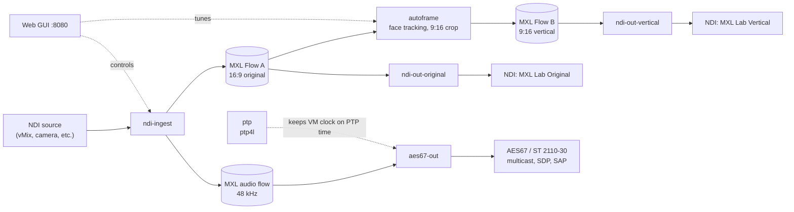

# MXL Lab

A self-contained lab for the [Media eXchange Layer (MXL)](https://github.com/dmf-mxl/mxl). It takes an NDI source, passes its video and audio through MXL shared-memory flows, crops the picture to a 9:16 vertical frame that follows faces, and sends the results back out: both pictures as NDI, and the audio as an AES67 stream that Dante and ST 2110-30 receivers can subscribe to. A PTP function keeps the audio timing aligned with the rest of the network. A web GUI for control.

It runs as Docker containers on a single Ubuntu VM, and one script takes a fresh VM to a working lab.

This is a fork of [mykeman/MXL-Lab](https://github.com/mykeman/MXL-Lab). It adds the MXL audio flow, AES67 output, PTP timing, and a tabbed GUI with a status overview.

This is a lab and learning tool, not a production system. See [Security](#security) before putting it on a shared network.

## Contents

- [What it does](#what-it-does)
- [The web GUI](#the-web-gui)
- [Requirements](#requirements)
- [Install](#install)
- [First run](#first-run)
- [Audio and PTP](#audio-and-ptp)
- [Manual install](#manual-install)
- [Testing](#testing)
- [NDI discovery](#ndi-discovery)
- [Configuration](#configuration)
- [Project layout](#project-layout)
- [Building and development](#building-and-development)
- [Troubleshooting](#troubleshooting)
- [Security](#security)
- [Known limitations](#known-limitations)
- [Credits and licence](#credits-and-licence)

## What it does



Each box is its own container. They share media through MXL flows in `/dev/shm/mxl`, so frames and samples move between them without being copied over the network or re-encoded.

- **ndi-ingest** receives the NDI source and writes its video to MXL Flow A and its audio to the MXL audio flow.
- **autoframe** reads Flow A, finds faces with the YuNet model in OpenCV, and moves a 9:16 crop window to follow them. The result goes to Flow B. All pixel work stays in GStreamer; Python only moves the crop.
- **ndi-out-original** and **ndi-out-vertical** send Flow A and Flow B out as NDI.
- **aes67-out** reads the audio flow and sends it as an AES67 or ST 2110-30 multicast stream, with an SDP file and SAP announcements. It can also send a test tone. Off until you turn it on.
- **ptp** runs ptp4l so the VM's clock follows the network's PTP grandmaster, or acts as one. Off until you turn it on.
- **gui** is the web page for all of the above.
- **ndi-discovery** is an optional NDI Discovery Server, for networks that don't use mDNS.

## The web GUI

Open `http://<vm-ip>:8080` once the lab is running. The page has four tabs. Each has a status dot: green when everything in it is running, amber for a warning or while a change is being applied, red for a fault, grey when it is turned off. The lamps in the header show every function from any tab.

**Status** is the page to leave open while the lab runs. A **Needs attention** list shows anything wrong, worst first, with a link to the tab that fixes it. Summary cards cover the NDI source, the framing, the audio output (with small level meters) and the PTP clock. Below them are the MXL flow rates and the list of functions, with logs and restart buttons.

**NDI** lists the NDI sources on the network. Pick one, or type a name or an `ip:port` address to connect directly. The source format is read from the source itself by default. Apply and restart starts the media functions in the right order with a clean MXL domain. This tab also sets how the lab discovers NDI sources.

**9:16 framing** shows a live preview with the crop window drawn over it, and the framing mode: follow the group, follow the nearest face, manual, or hold. In manual mode, drag the window on the preview. The tuning sliders set follow speed, speed limit, deadband, return to centre, detection confidence and more. Changes apply within half a second, with no restart.

**AES67 and clock** has the audio output on one side and PTP timing on the other. The audio side shows level meters, where the stream goes and how late packets leave, and sets the stream format, network settings and SAP. It also offers the SDP file for download. The PTP side shows the port state, the offset from the grandmaster with a two-minute graph, and the grandmaster's details, and sets the role, profile and every main ptp4l setting.

The address bar keeps the tab (`#status`, `#ndi`, `#framing`, `#audio`), so a reload or bookmark opens the same one.

## Requirements

- An x86_64 VM (or machine) running **Ubuntu Server 24.04 or 26.04**.
- A CPU with **AVX2**. In Proxmox, set the VM's CPU type to `host`.
- **8 cores, 16 GB RAM** recommended, with memory ballooning off.
- About **30 GB free disk** for the image build.
- The VM on the **same network or VLAN as your NDI sources**, and for audio, as your Dante or ST 2110 devices.
- Internet access during setup, to download the NDI SDK and build dependencies.

For audio into Dante or ST 2110 devices you also need:

- Multicast working on that VLAN. With IGMP snooping on, the VLAN needs an IGMP querier.
- A PTP grandmaster on the network, or the lab acting as one.
- Optionally, a network card with hardware timestamping passed through to the VM. It works without one, but timing is much tighter with one. See [Hardware timestamping](#hardware-timestamping).

You will be asked to accept the NDI SDK licence during setup. The NDI SDK is not part of this repository.

## Install

```bash
sudo apt-get install -y git tmux
git clone https://github.com/YOUR-ACCOUNT/MXL-Lab.git mxl-lab
cd mxl-lab
tmux new -s setup
./setup.sh
```

Run it as your normal user, not root. It uses `sudo` where it needs to.

The script:

1. Checks the VM: Ubuntu, x86_64, AVX2, RAM and free disk.
2. Installs host packages and starts avahi for mDNS.
3. Opens the NDI, PTP, SAP and GUI ports, if `ufw` is active.
4. Creates `/dev/shm/mxl` and a rule that recreates it at every boot.
5. Offers to turn off NTP on the VM, which PTP needs (see [PTP](#ptp)).
6. Installs Docker.
7. Downloads the NDI SDK and runs its installer so you can accept the licence, then copies the NDI runtime and Discovery Server into `ndi/`.
8. Creates `.env` and offers a list of the NDI sources it can see.
9. Builds the images. The first build takes **30 to 60 minutes**.
10. Starts the lab and checks the GUI, the GStreamer plugins and the first MXL flow.

It is safe to run again. Completed steps are skipped, and the Docker build cache means a rerun after a failure picks up close to where it stopped. Everything is logged to `setup.log`.

The build is long, which is why the commands above use `tmux`: if your SSH session drops, the build keeps running. Reconnect with `tmux attach -t setup`.

| Option | Effect |
|---|---|
| `--source "NAME"` | Set the NDI source without the prompt |
| `--accept-ndi-eula` | Accept the NDI licence without showing it |
| `--disable-ntp` | Turn off NTP on the VM without asking |
| `--keep-ntp` | Leave NTP running without asking |
| `--skip-build` | Do the host preparation only, stop before the build |

When it finishes, it prints the GUI address.

## First run

1. Open the GUI and go to the **NDI** tab. Pick your source from the list and click **Apply and restart**.
2. Watch the **Status** tab. Within a few seconds every function should be running, and Flow A and Flow B should show the source frame rate.
3. "MXL Lab Original" and "MXL Lab Vertical" appear under the VM's hostname in NDI Studio Monitor or any NDI receiver.
4. On the **9:16 framing** tab, pick a framing mode and adjust the tuning to taste.

Audio output and PTP are both off after install. The next section covers turning them on.

## Audio and PTP

### How the timing works

MXL timestamps media with the Linux `CLOCK_TAI` clock. The AES67 sender runs on that same clock, so each packet's RTP timestamp is its sample time in PTP time, which is what AES67 and ST 2110 receivers expect. The ptp function runs ptp4l on the VM's own kernel, so it steers the VM's clock. It also keeps the kernel's TAI offset in line with the grandmaster, so that `CLOCK_TAI` reads PTP time.

Audio reaches MXL a little after its timestamp, roughly one NDI audio chunk. So the sender reads MXL a fixed time behind (the **read delay**) and moves its timestamps forward by the same amount. Packets then leave within a fraction of a millisecond of their timestamp, and receivers only need a normal latency setting.

### PTP

Before turning PTP on, NTP on the VM has to be off, or NTP and ptp4l will fight over the clock. `setup.sh` offers to do this, or run `sudo timedatectl set-ntp false`.

In the **AES67 and clock** tab, under PTP timing:

- **Role.** Use **Follow only** when the network has a grandmaster, which is usually the case with Dante or ST 2110. Use **Can be grandmaster** when it has none. The VM then leads when nothing better is present. Off leaves the VM clock alone, and receivers locked to PTP will drift against the stream.
- **Profile.** **Dante, AES67** sets the AES67 media profile on domain 0. **ST 2110, ST 2059-2** sets domain 127 and the ST 2059-2 message rates. **Custom** is anything else.
- **Interface and timestamping.** Choose the network interface that faces the audio network. Hardware timestamping is offered when that interface supports it.

Click **Apply timing**. The lab restarts PTP, waits for it to settle, then restarts the media functions, because the first lock usually steps the clock. The panel should show **Following** (or **Grandmaster**), with a steady offset and the grandmaster's details.

If the grandmaster's time jumps later, for example when a grandmaster reboots or another device takes over, ptp4l steps the clock to follow, and the GUI restarts the media functions by itself.

### Sending to Dante

1. Set PTP to **Follow only** with the **Dante, AES67** profile, and apply. Wait for **Following**.
2. In Dante Controller, turn on AES67 mode on the receiving device, and reboot it if asked.
3. In **Audio out**, tick **Send AES67 audio**. Keep 1 ms packets, L24, up to 8 channels and SAP on. Apply.
4. The stream appears in Dante Controller's routing view as a multicast flow with the session name. Subscribe to it like any other flow.
5. Set the receiver's latency above the **Leaves after** figure plus your network. See [Latency](#latency).

Use the **Test tone** source first to check the network path, before bringing in an NDI source.

### Sending to ST 2110-30 receivers

Choose the **ST 2110, ST 2059-2** profile, set the role to suit the network, and download the SDP from the Audio out panel for your receiver or broadcast controller. With this profile the SDP includes a SMPTE 2110 channel order. There is no NMOS registration, so the SDP file is how receivers find the stream.

### Latency

The Audio out panel shows two figures:

- **Arrives from MXL**: how long after its timestamp audio reaches the sender. The **read delay** (default 60 ms) must stay above this figure. The panel turns it red if it doesn't.
- **Leaves after**: how long after its timestamp each packet leaves the VM. With **send delay** at -1 ms, this is about 0.2 ms.

A receiver's latency has to cover the Leaves after figure, the network, and the difference between the VM's clock and its own. With hardware timestamping, a receive latency of 2 to 3 ms is realistic. With software timestamping in a VM, start at 5 ms.

The read delay shifts audio later relative to the NDI video outputs by the same amount.

### Hardware timestamping

A virtual network card only supports software timestamping. That works, but PTP offsets are typically tens to hundreds of microseconds, and more on a busy host. A network card with hardware timestamping, passed through to the VM, brings this down to microseconds.

Check the host's card with `ethtool -T <nic>`: it should list `hardware-transmit`, `hardware-receive` and a PTP Hardware Clock. To pass one port through in Proxmox:

1. Enable VT-d (Intel) or AMD-Vi in the BIOS. Check it's active with `dmesg | grep -e DMAR -e IOMMU`. On older kernels, add `intel_iommu=on iommu=pt` to the kernel command line.
2. Load the VFIO modules and reboot the host:
   ```bash
   printf "vfio\nvfio_iommu_type1\nvfio_pci\n" >> /etc/modules
   update-initramfs -u -k all
   ```
3. Find the port's PCI address with `ethtool -i <nic> | grep bus-info`. Check it sits in its own IOMMU group.
4. Remove the port from any bridge or bond on the host. Then add it to the VM: Hardware, Add, PCI Device, Raw Device. Stop and start the VM.
5. In the VM, give the new interface an address on the audio network, with no gateway.
6. In the GUI, choose it as the PTP and Audio out interface, set Timestamping to **Hardware**, and apply.

Connect the port to a single switch port, not a port-channel. The switch should either pass PTP through or act as a boundary clock on that port.

## Manual install

These are the same steps the script runs, for anyone who wants to see or control each one. Run them from the cloned `mxl-lab` folder.

### 1. Prepare the host

```bash
sudo apt-get update
sudo apt-get install -y ca-certificates curl wget tar unzip python3 avahi-daemon avahi-utils
sudo systemctl enable --now avahi-daemon

# MXL domain, recreated at every boot
echo "d /dev/shm/mxl 0777 root root -" | sudo tee /etc/tmpfiles.d/mxl.conf
sudo systemd-tmpfiles --create /etc/tmpfiles.d/mxl.conf

# PTP steers the clock, so NTP has to be off if you will use it
sudo timedatectl set-ntp false
```

If `ufw` is active, open NDI, PTP, SAP and the GUI:

```bash
for rule in 5353/udp 5959:5969/tcp 5959:5969/udp 6960:6970/tcp 6960:6970/udp \
            7960:7970/tcp 7960:7970/udp 8080/tcp 319/udp 320/udp 9875/udp; do
  sudo ufw allow "$rule"
done
```

### 2. Install Docker

```bash
curl -fsSL https://get.docker.com | sudo sh
sudo usermod -aG docker "$USER"
```

Log out and back in so `docker` works without `sudo`. If `get.docker.com` does not support your Ubuntu release yet, `sudo apt-get install -y docker.io docker-compose-v2` works too.

### 3. Get the NDI runtime

```bash
mkdir -p ~/src/ndi-sdk && cd ~/src/ndi-sdk
wget https://downloads.ndi.tv/SDK/NDI_SDK_Linux/Install_NDI_SDK_v6_Linux.tar.gz
tar -xzf Install_NDI_SDK_v6_Linux.tar.gz
PAGER=cat ./Install_NDI_SDK_v6_Linux.sh      # read and accept the licence
cd -

mkdir -p ndi
cp -L "$(find ~/src/ndi-sdk -name 'libndi.so.6*' -path '*x86_64-linux-gnu*' | sort | head -1)" ndi/libndi.so.6
cp -L "$(find ~/src/ndi-sdk -type f -iname '*discovery*server*' -path '*x86_64*' | sort | head -1)" ndi/ndi-discovery-server
chmod +x ndi/ndi-discovery-server
```

Use `cp -L`. A symlink in `ndi/` breaks the Docker build.

### 4. Configure

```bash
cp env.example .env
mkdir -p config
chmod +x scripts/*.sh scripts/*.py
scripts/ndi-mode.sh mdns --config-only
```

Edit `.env` if you want to set the NDI source now. Otherwise pick it in the GUI later. Set `UBUNTU_VERSION` to your VM's release (for example `26.04`) so the container matches the host.

### 5. Build

```bash
docker compose build ndi-ingest      # the main image, 30 to 60 minutes the first time
docker compose build gui             # a minute or two
```

### 6. Start

```bash
docker compose up -d --no-deps gui ndi-discovery ptp
docker stop mxl-ndi-discovery        # leave it running only if you use the internal discovery server
docker compose create ndi-ingest autoframe ndi-out-original ndi-out-vertical aes67-out
scripts/lab-apply.sh
```

`lab-apply.sh` starts the media functions in order: ingest first, then waits for Flow A, then the rest. If no source is set in `.env`, it says so. Open the GUI, pick a source and click Apply and restart instead.

Avoid starting all the media functions at once with a plain `docker compose up -d`. An output can attach to a flow that is being replaced and sit there with no picture. The GUI and `lab-apply.sh` both avoid this.

## Testing

Work through these in order. Each one checks a layer the next depends on.

**Containers are running**

```bash
docker compose ps
```

All functions should show `running`, not `restarting`. PTP and aes67-out also show running while turned off; they wait until they're switched on.

**The GStreamer plugins load**

```bash
docker compose run --rm --no-deps --entrypoint sh autoframe -c \
  'gst-inspect-1.0 mxlsink >/dev/null && gst-inspect-1.0 ndisrc >/dev/null && gst-inspect-1.0 rtpL24pay >/dev/null && echo plugins ok'
```

A warning that `libgstmxl.so` has an unknown licence "Apache-2.0" is harmless.

**NDI sources are visible**

From the host:

```bash
avahi-browse -rt _ndi._tcp
```

From inside a container:

```bash
docker compose exec gui timeout 10 gst-device-monitor-1.0 -f Source/Network:application/x-ndi
```

If the host sees sources and the container doesn't, see [Troubleshooting](#troubleshooting).

**A source can be received**

Replace the address with your sender's IP and port from `avahi-browse`:

```bash
docker compose stop ndi-ingest
docker compose run --rm --no-deps ndi-ingest \
  timeout 15 gst-launch-1.0 -v ndisrc url-address=192.168.1.10:5961 \
  ! ndisrcdemux name=d d.video ! fakesink d.audio ! fakesink
```

Video caps with the source's width and height should print, and it should run the full 15 seconds. Start the lab again afterwards with `scripts/lab-apply.sh`.

**The MXL flows are moving**

```bash
ls /dev/shm/mxl
docker compose exec gui mxl-info -d /dev/shm/mxl -l
```

There should be three `.mxl-flow` directories: Flow A, Flow B and the audio flow (if the source sends audio). The Status tab shows each flow's rate. Video should match the source frame rate, and audio should be close to 48k samples a second.

**The outputs arrive**

"MXL Lab Original" and "MXL Lab Vertical" should appear under the VM's hostname in any NDI receiver. For audio, turn on the AES67 output with the test tone and check it appears in Dante Controller or plays on your ST 2110 receiver.

**PTP is locked**

```bash
docker compose logs --tail 20 ptp
```

With PTP on, the log should show the port reach `SLAVE` (following) or `MASTER` (grandmaster). The PTP panel shows the same, with the offset and the grandmaster's time.

## NDI discovery

Containers cannot use mDNS by default: Docker's AppArmor profile blocks the D-Bus connection NDI uses to reach avahi. The NDI containers here run with `apparmor:unconfined` for that reason. Three discovery methods are available, set in the NDI tab or with `scripts/ndi-mode.sh`:

| Method | When to use it | Command |
|---|---|---|
| mDNS | Default. Any NDI machine on the VLAN sees the lab, nothing to set on other PCs | `scripts/ndi-mode.sh mdns` |
| Internal server | Runs the NDI Discovery Server on this VM. Add the VM's IP in NDI Access Manager on each PC | `scripts/ndi-mode.sh local` |
| External server | You already run a discovery server | `scripts/ndi-mode.sh external 192.168.1.20` |

## Configuration

Settings live in `.env`. Choices made in the GUI are saved in `config/` and take priority over `.env`.

| Setting | Default | Meaning |
|---|---|---|
| `NDI_SRC` | blank | NDI source name, exactly as NDI shows it |
| `NDI_URL` | blank | Optional `ip:port` of the sender, skips discovery |
| `SRC_AUTO` | `true` | Read the format from the source. `false` uses the next three |
| `SRC_W`, `SRC_H`, `SRC_FPS` | `1920`, `1080`, `50` | Source format when not automatic |
| `OUT_W`, `OUT_H` | `1080`, `1920` | Vertical output size |
| `SCALER` | `lanczos` | `lanczos`, `4-tap` or `bilinear`. Sharpest to lightest on CPU |
| `PREVIEW_FPS` | `12` | Frame rate of the GUI preview |
| `GUI_PORT` | `8080` | Web GUI port |
| `GUI_BIND` | `0.0.0.0` | Address the GUI listens on. Set the VM's management address to keep it off the media network |
| `GUI_USER`, `GUI_PASSWORD` | blank | Optional login for the GUI. Both must be set to turn it on |
| `NDI_DISCOVERY` | `mdns` | Discovery method for a fresh install |
| `FLOW_A`, `FLOW_B`, `FLOW_AUDIO` | fixed UUIDs | MXL flow IDs |
| `UBUNTU_VERSION` | `24.04` | Ubuntu release for the container base |

Audio and PTP are set in the GUI only, and saved in `config/audio.json` and `config/ptp.json`. The current SDP is written to `config/aes67.sdp`.

| Audio setting | Default | Meaning |
|---|---|---|
| Channels | 2 | 1, 2, 4 or 8. Source channel 1 goes to output channel 1 and so on |
| Encoding | L24 | L24 or L16 |
| Packet time | 1 ms | 1 ms (AES67, Dante, 2110-30 level A) or 125 us (2110-30 level C) |
| Multicast address, port | 239.69.10.1, 5004 | Where the stream goes |
| Read delay | 60 ms | How far behind MXL time the sender reads |
| Send delay | 1 ms | Added to the sender's own 1 ms of buffering. -1 sends packets at their timestamp |
| SAP | on | Announce the stream so Dante Controller finds it |

`autoframe.py` and the `scripts/` folder are mounted into the containers, so changes to them only need a restart of the function, not a rebuild. The same goes for the GUI files in `gui/`.

## Project layout

```
mxl-lab/
  setup.sh                 install script
  Dockerfile               lab image: MXL, NDI and MXL GStreamer plugins, OpenCV, YuNet, linuxptp
  docker-compose.yml       the eight containers
  env.example              settings template, copied to .env
  autoframe.py             face tracking and 9:16 crop
  pyproject.toml           lint settings (ruff)
  scripts/
    run-ingest.sh          NDI to Flow A and the audio flow
    run-out-original.sh    Flow A to NDI
    run-out-vertical.sh    Flow B to NDI
    aes67_out.py           audio flow to AES67 multicast, with SDP, SAP and level meters
    run-ptp.py             ptp4l and phc2sys from the GUI settings
    ptp_common.py          PTP, pmc and network helpers shared by the above and the GUI
    lab-apply.sh           ordered start of the media functions
    ndi-mode.sh            switch NDI discovery method
    load-config.py         merges GUI settings over .env
    gui-api.sh             shared helper for scripts that call the GUI's API
    pin-from-image.sh      pin the Dockerfile to the versions in a built image
  gui/
    Dockerfile             GUI image, built on the lab image
    app.py                 HTTP API (FastAPI)
    lab/                   GUI backend: settings, NDI discovery, Docker control,
                           status monitors, ordered apply jobs
    static/                the page: index.html, app.js, app.css
  ndi/                     NDI runtime, created by setup, never committed
  config/                  runtime settings and state, never committed
```

## Building and development

**Pinned versions.** The Dockerfile pins every upstream source it builds from: MXL, vcpkg and gst-plugins-rs to exact commits, the Rust toolchain, the OpenCV wheel, and the YuNet model, which is checked against its SHA-256. Two builds of the same commit of this repository get the same code. To move to newer upstream versions, change the `ARG` lines at the top of the Dockerfile and rebuild.

If you have a working image and want the Dockerfile to match it exactly, run:

```bash
scripts/pin-from-image.sh --dry-run   # show the versions built into mxl-lab:latest
scripts/pin-from-image.sh             # write them into the Dockerfile
```

**Linting.** Python is checked with [ruff](https://docs.astral.sh/ruff/) and shell scripts with [shellcheck](https://www.shellcheck.net/):

```bash
ruff check .
shellcheck -x setup.sh scripts/*.sh
```

There is no automated test suite; this is a lab project. Changes are checked by running the lab and watching the Status tab, and the [Testing](#testing) steps above.

## Troubleshooting

The Status tab's Needs attention list catches most problems and links to the right tab. The entries below cover the rest.

### NDI and video

**No NDI sources inside the containers, but the host sees them.** Check for AppArmor denials:

```bash
sudo journalctl -k --since "1 hour ago" | grep 'apparmor="DENIED"' | tail
```

Denials mentioning `dbus` mean a container is running without `apparmor:unconfined`. Recreate it with `docker compose up -d --force-recreate <service>`. As a workaround, put the sender's address in the NDI tab's Address field, or switch to a discovery server.

**Ingest restarts every 10 seconds with "EOS without available srcpad(s)".** It never received a frame. The source name doesn't match exactly, or the source can't be discovered. Check the name against `avahi-browse -rt _ndi._tcp`, or set the Address.

**An output shows no picture after a restart.** It likely attached to a flow that was being replaced. Use Apply and restart in the GUI, or `scripts/lab-apply.sh`.

**The preview is blank.** Check "Show detection preview" is ticked on the 9:16 framing tab, and that autoframe is running.

**The image build fails.** The build pulls MXL, vcpkg and gst-plugins-rs from their main branches, so upstream changes can break it. The end of `setup.log` shows the failing step. Fix and run `./setup.sh` again; finished layers are reused.

### Audio

**Dante Controller does not list the stream.** Check that AES67 mode is on for the receiving device, that SAP is ticked, and that the VM and the Dante device are on the same VLAN with multicast allowed. IGMP snooping without a querier can block both SAP and the stream. On Proxmox, the host bridge can also filter multicast; `bridge-mcsnoop 0` on the bridge rules that out.

**The stream subscribes but no audio plays, or the receiver reports late packets.** Check, in order:

1. PTP shows Following or Grandmaster.
2. **Arrives from MXL** is below the read delay.
3. **Leaves after** is below the receiver's latency.
4. The offset graph is steady.

If all four look right, raise the receiver's latency.

**The Audio flow card says Not present.** The NDI source is not sending audio. Check the ndi-ingest log, and use the test tone to check the AES67 side on its own.

### PTP

**Stays on Listening.** No grandmaster is heard on that domain. Check the domain, the interface, and that UDP 319 and 320 reach the VM. On a network without a grandmaster, choose Can be grandmaster.

**Stays on Locking.** The VM hears the grandmaster's Announce messages but no Sync and Delay exchange completes. Capture with `sudo tcpdump -ni <iface> 'udp port 319 or udp port 320'`:

- **No Sync from the grandmaster:** timing messages aren't reaching the VM.
- **The VM's Delay_Req goes out but no Delay_Resp comes back:** the grandmaster or switch isn't answering. Check that the switch port runs PTP on domain 0 with end-to-end delay. The lab sends PTP 2.0 headers, which every PTPv2 device accepts.
- **Announce from more than one switch port:** the VM is reachable through more than one link, for example a port-channel. PTP needs a single physical path. Use a separate, non-bonded link for PTP and audio.

**Works after a VM reboot, but stops after the grandmaster reboots or changes.** Check the grandmaster's time in the PTP panel. Some devices, including Dante devices without a real-time clock, restart their PTP time from near 1970 when they reboot. Linux will step its clock to any time after the VM booted, but not to one before it. Right after a VM reboot the grandmaster's time is usually later than that, so the VM follows it, but the VM's own clock then reads 1970, which breaks certificate checks and logs. Once the VM has been up longer than the grandmaster, a grandmaster restart puts its time before the VM's boot. Every step is then refused, the offset stays pinned, and restarting PTP does not help. Needs attention flags this case. The fix is on the clock side: give the network a grandmaster with real time, or let the VM lead by choosing Can be grandmaster and setting Priority 1 below the other device's value. Dante announces 249, so 128 works.

A grandmaster jump to any other time, forward or back, is handled: ptp4l steps the clock when the offset passes 1 s, and the GUI restarts the media functions.

**"timed out while polling for tx timestamp" in the PTP log.** Common on virtual network cards. The lab already raises the timeout to 50 ms. If it continues, the host is too busy to timestamp reliably; consider [hardware timestamping](#hardware-timestamping).

## Security

This is built for a lab network. Before running it anywhere else, note that:

- The GUI has **no login**. Anyone who can reach port 8080 can change the pipeline.
- The GUI container mounts the **Docker socket**, which gives it root-level control of the VM.
- The NDI containers run with **AppArmor turned off** so mDNS works.
- The ptp container runs **privileged**, so it can set the VM's clock and reach the network card's hardware clock.

Keep the VM on a trusted VLAN and don't expose port 8080 to the internet. Two settings in `.env` reduce the exposure: `GUI_BIND` limits the GUI to one address, such as a management interface, and `GUI_USER` with `GUI_PASSWORD` turns on a login. The login keeps casual visitors out; it does not make the GUI safe to put on an untrusted network.

## Known limitations

- Only landscape sources are supported, up to 4096x2160.
- Tested with a 1080p50 vMix source, and with a Dante AVIO in AES67 mode as the audio receiver. Fractional frame rates such as 59.94 are passed through but have not been tested end to end.
- The source format is read when you apply. If the sender changes format later, ingest keeps scaling to the earlier format until you apply again.
- Face boxes in the preview update at the detection rate, so they can trail the picture slightly.
- The NDI outputs carry video only. Audio leaves the lab as AES67.
- NDI audio arrives on the sender's clock, not PTP. Ingest keeps the audio flow continuous, so it occasionally inserts or drops a sample when the two drift apart. Expect a rare small glitch on long runs.
- The thresholds behind the Status tab's warnings, such as 2.5 ms for late packets and 1 ms for PTP offset, are lab defaults rather than values from a standard. They are listed together at the top of `gui/static/app.js`.
- There is no NMOS registration for the AES67 stream. Dante finds it through SAP; ST 2110 receivers need the SDP file.

## Credits and licence

Built by [Rankin Network](https://rankin.network).

Copyright 2026 Michael Rankin. Licensed under the [Apache License 2.0](LICENSE). You may use, change and share this project, including commercially, as long as you keep the copyright notice and licence, include the [NOTICE](NOTICE) file, and state which files you changed.

This project builds on MXL, GStreamer and the gst-plugins-rs NDI plugin, OpenCV and the YuNet face model, and linuxptp, among others. See [THIRD-PARTY.md](THIRD-PARTY.md) for each component and its licence. The NDI SDK is not included and has its own terms.

### Face detection model

Autoframing uses the YuNet face detection model from [opencv_zoo](https://github.com/opencv/opencv_zoo/tree/main/models/face_detection_yunet), downloaded when the image is built. YuNet is licensed under the MIT License, Copyright (c) 2020 Shiqi Yu. If you use this project in your work, please also cite the YuNet paper:

```bibtex
@article{wu2023yunet,
  title={Yunet: A tiny millisecond-level face detector},
  author={Wu, Wei and Peng, Hanyang and Yu, Shiqi},
  journal={Machine Intelligence Research},
  volume={20},
  number={5},
  pages={656--665},
  year={2023}
}
```

NDI® is a registered trademark of Vizrt NDI AB.
